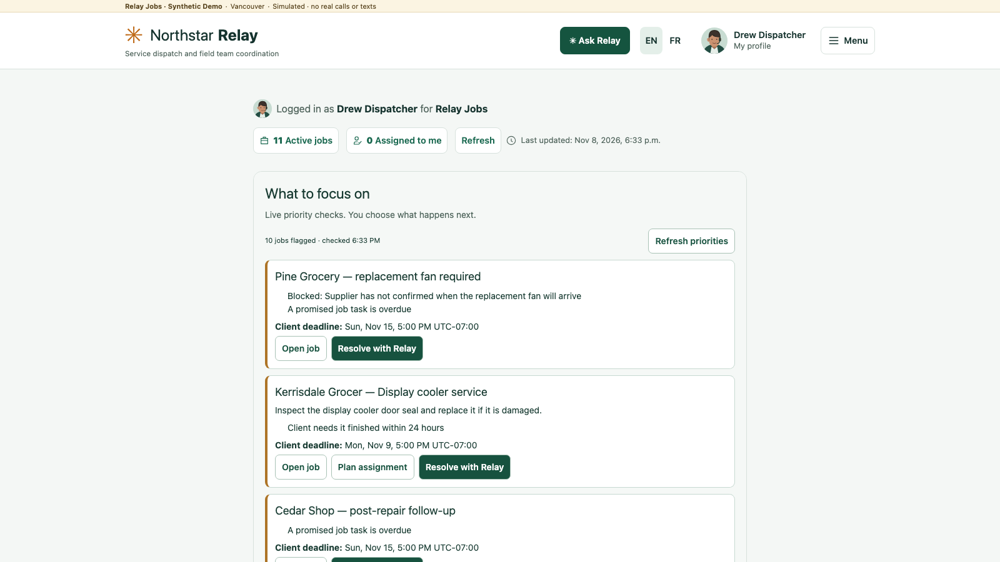
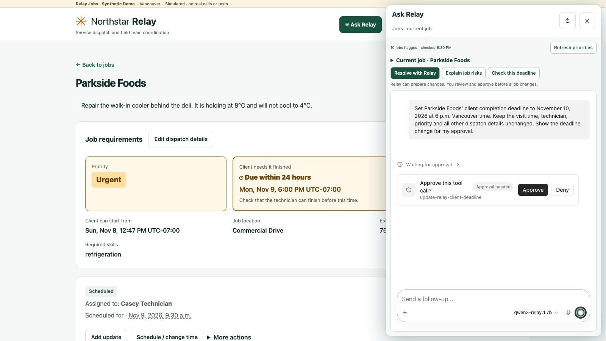
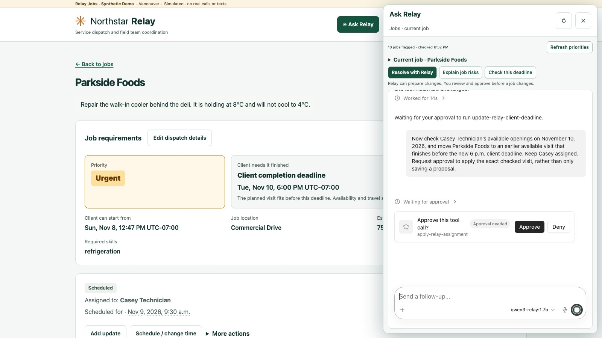
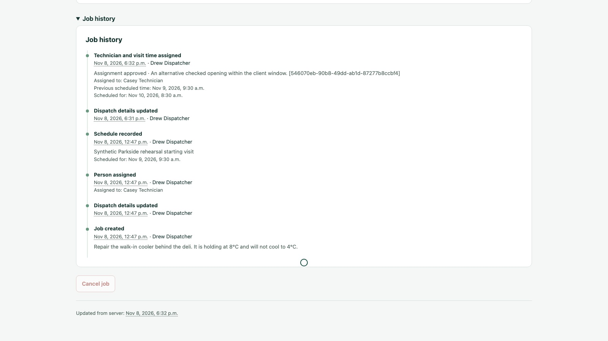
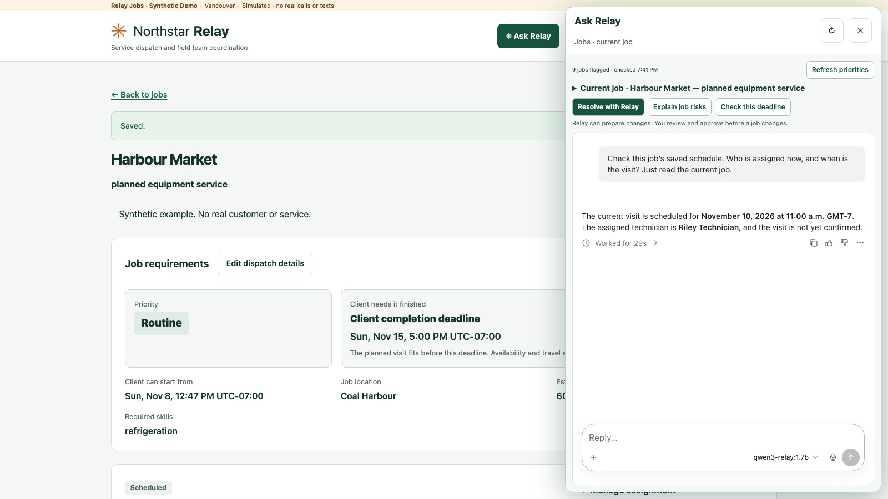
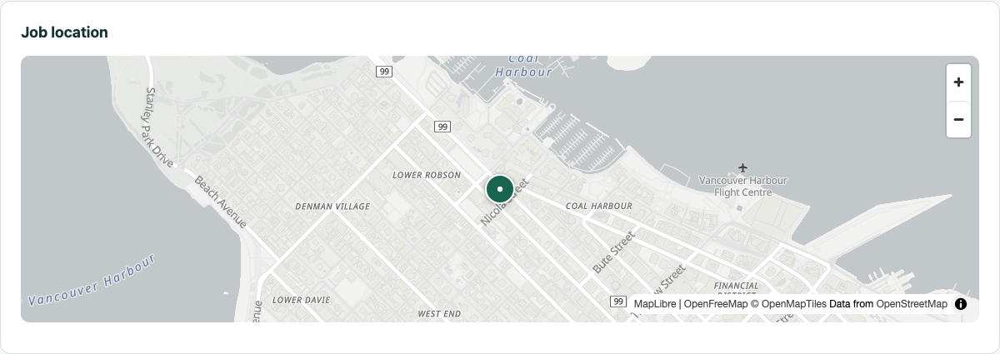
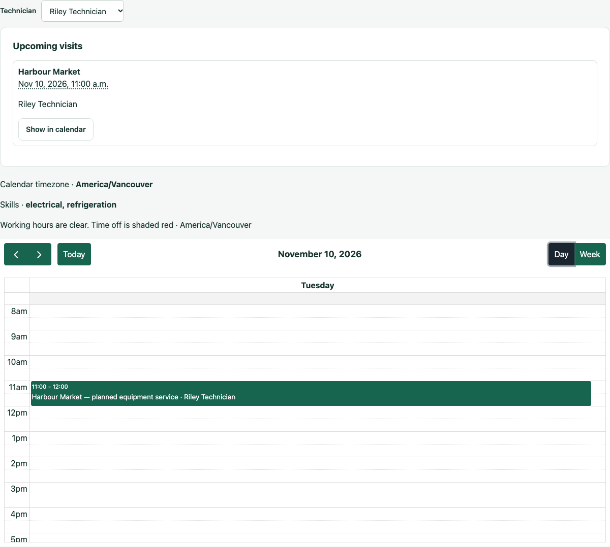

# Northstar Relay

**A user friendly dispatch app built with Agent Native.**

Northstar Relay is a service dispatch app for technicians and the dispatchers who schedule them. Dispatchers can see which jobs need attention, assign technicians, and plan visits with a job map and calendar. Technicians can see what needs fixing and where to go. With Ask Relay built into the job page using Agent Native, Northstar Relay shows what the next generation of service dispatch can look like. Dispatchers can edit jobs directly or ask the agent to check availability and propose a visit. The agent helps work out the plan, and the dispatcher decides what gets saved to the shared job record.

We built Ask Relay and the new dispatch planning tools for the **2026 Builder.io Agent-Native Hackathon**, extending Northstar Relay’s existing work-order and scheduling app. [Builder.io hackathon](https://www.builder.io/hackathon)

[See the screenshots](#walkthrough-in-screenshots) · [Run the demo locally](#run-the-synthetic-demo) · [What we built during the hackathon](#what-was-built-during-the-hackathon)

## Watch the Northstar Relay demo

Watch Parkside Foods from **0:41** for two approvals in one conversation. At **2:00**, Harbour Market shows the reverse direction. Drew edits the assignment on the job page, then Ask Relay reads the saved change.

https://github.com/user-attachments/assets/308244f3-e3f1-47f8-bb7f-99b310aa722b

[Full-resolution video on GitHub Releases](https://github.com/sparkplug604/northstar-relay/releases/tag/hackathon-demo)

## Why we built with Agent-Native

Dispatchers switch between quick edits and decisions that take several checks. Agent-Native gives Ask Relay the current job as context and lets it use typed actions against the same Relay API as the job page. A manual edit is available on the agent’s next read. When the agent proposes a write, an Agent-Native approval card gives the dispatcher a chance to review the exact change. Relay checks the job version, applies the change, and verifies the record before reporting success. [Agent-Native framework](https://github.com/BuilderIO/agent-native)

The hackathon asks for an agent with a useful job, a person who can guide and act on its work, and an interface connected to the same data and actions. Here’s how that plays out in Relay. [Hackathon challenge and judging](https://www.builder.io/hackathon)

- **Usefulness and execution.** Changing a client deadline and booking a visit are separate decisions. In the Parkside walkthrough, Drew works through both in one conversation, and the app records each change under his name.
- **Creativity and design.** Home triage opens Ask Relay on the job that needs attention. The job page stays visible beside the conversation, so Drew can read the proposal, make a direct edit, or check the result in place.
- **Innovation.** Ask Relay checks the work against technician skills, hours, time off, existing visits, travel, and the client’s deadline. It brings Drew a specific opening to review.
- **Use of Agent-Native.** We embedded the Chat template and used `defineAction()` for live reads, checked scheduling, and approval-gated writes. Both paths use the same Relay record, as the Harbour Market readback demonstrates. [Agent actions](agent/actions/)

## Walkthrough in screenshots

### Home triage helps Drew decide what to check

The **What to focus on** list puts blockers and deadline risks next to the jobs they affect. **Resolve with Relay** opens a conversation about the selected job.



### Parkside approval 1 moves the client deadline

Ask Relay opens beside Parkside Foods. Drew can review the requested **November 10 at 6 p.m.** completion deadline and approve that change while the current visit remains visible.



### Parkside approval 2 saves the checked visit

In the same conversation, Ask Relay presents a checked **8:30 a.m.** visit with Casey Technician. The job page already shows the new deadline, giving Drew both dates as he reviews the second approval.



### Job History shows both changes under Drew’s name

The history records the dispatch details update and the visit assignment as two separate events. Drew can verify what saved after closing the chat.



### Harbour Market shows a manual edit reaching Ask Relay

Drew reassigns the job to Riley Technician in Relay. When he asks who’s assigned and when the visit is scheduled, Ask Relay reads the saved job and returns **Riley at 11 a.m. on November 10**.



### Map and calendar give the dispatcher two planning views

The job map locates Harbour Market in Coal Harbour. The technician calendar shows the same visit in Riley’s day.





## Run the synthetic demo

Use macOS or Linux with Node.js 22.22 or newer, npm, pnpm 11, and Ollama. Run as a normal user so embedded PostgreSQL can initialize. Start Ollama on its default local port before creating the model. The install downloads dependencies, and Qwen requires about 1.4 GB of model storage.

```bash
git clone https://github.com/sparkplug604/northstar-relay.git
cd northstar-relay
./demo.sh install

ollama pull qwen3:1.7b
ollama create qwen3-relay:1.7b -f demo/Qwen.Modelfile

./demo.sh start
./demo.sh credentials
```

Open [Relay Home](http://127.0.0.1:3004/relay) and sign in as the generated synthetic dispatcher. Startup prints links for Parkside Foods and Harbour Market, plus the target date for your seeded Parkside scenario. Dates are chosen at first startup so the scheduling exercise uses future working days.

1. On **Parkside Foods**, open **Ask Relay**. Ask it to set the client completion deadline to the printed target date at 6 p.m. Vancouver time. Review the approval card and click **Approve**.
2. In the same chat, ask it to check Casey’s availability on that date and propose a visit that finishes before 6 p.m. Approve the visit, close chat, and open **Job History**.
3. Open **Harbour Market**. Under **Manage assignment → Change assignee → Choose a person manually**, select Riley and save. Open **Ask Relay** and ask who’s assigned and when the visit is scheduled.

The demo runs on loopback and uses simulated communications. Map tiles load from OpenFreeMap. Travel checks use OSRM with synthetic locations. `./demo.sh stop` stops the owned services. `./demo.sh start` resumes saved jobs and chat. To rehearse from the original baseline again, use a fresh clone.

## Source map

| Path | Purpose |
| --- | --- |
| [relay/](relay/) | Relay UI, API, domain rules, PostgreSQL migrations, and tests |
| [agent/actions/](agent/actions/) | Agent-Native actions for job reads, checked scheduling, and approved writes |
| [agent/app/routes/](agent/app/routes/) | Embedded Ask Relay, assignment, and recovery interfaces |
| [demo/](demo/) | Local service supervision, synthetic fixtures, Qwen configuration, and browser rehearsal |

Run `npm run build:all` in `relay/` and `pnpm typecheck && pnpm test && pnpm agent-native:doctor` in `agent/`. With the demo freshly seeded and Google Chrome installed, run `node demo/verify.mjs` from the root. The rehearsal saves the two Parkside approvals and the Harbour Market reassignment and checks the agent’s readback.

## What was built during the hackathon

For the Builder.io hackathon, we added Ask Relay to Home triage, Jobs, and the assignment workflow. We built the checked scheduling and approval flow, job-scoped chat, the shared recovery board, technician availability and travel checks, map and calendar views, and a repeatable synthetic demo.

The browser rehearsal verified both Parkside approvals in one chat and the Harbour Market reassignment readback. The approved changes and history persisted across a restart.

The pre-existing Relay app supplied sign-in, intake and work-order acknowledgements, jobs, manual assignment and scheduling, commitments, and Job History.

## Third-party components

- Agent-Native 0.224.0 and its Chat template. [Framework](https://github.com/BuilderIO/agent-native) · [Upstream license](agent/UPSTREAM-LICENSE)
- Qwen3-1.7B and Ollama for local tool-calling inference. [Qwen3](https://huggingface.co/Qwen/Qwen3-1.7B) · [Ollama](https://github.com/ollama/ollama)
- MapLibre GL JS and OpenFreeMap tiles with OpenStreetMap data, FullCalendar, and the OSRM routing adapter. [MapLibre](https://github.com/maplibre/maplibre-gl-js) · [OpenFreeMap](https://openfreemap.org/) · [FullCalendar](https://github.com/fullcalendar/fullcalendar) · [OSRM](https://github.com/Project-OSRM/osrm-backend)
- The video uses synthetic jobs and real app footage. Narration was made in Voicebox using Kokoro’s Heart voice. Music and sound effects were synthesized for the video. [Kokoro](https://huggingface.co/hexgrad/Kokoro-82M)
